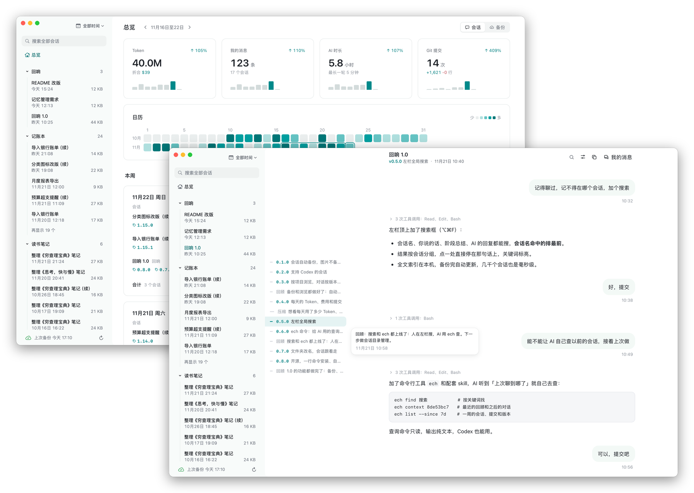
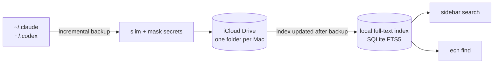
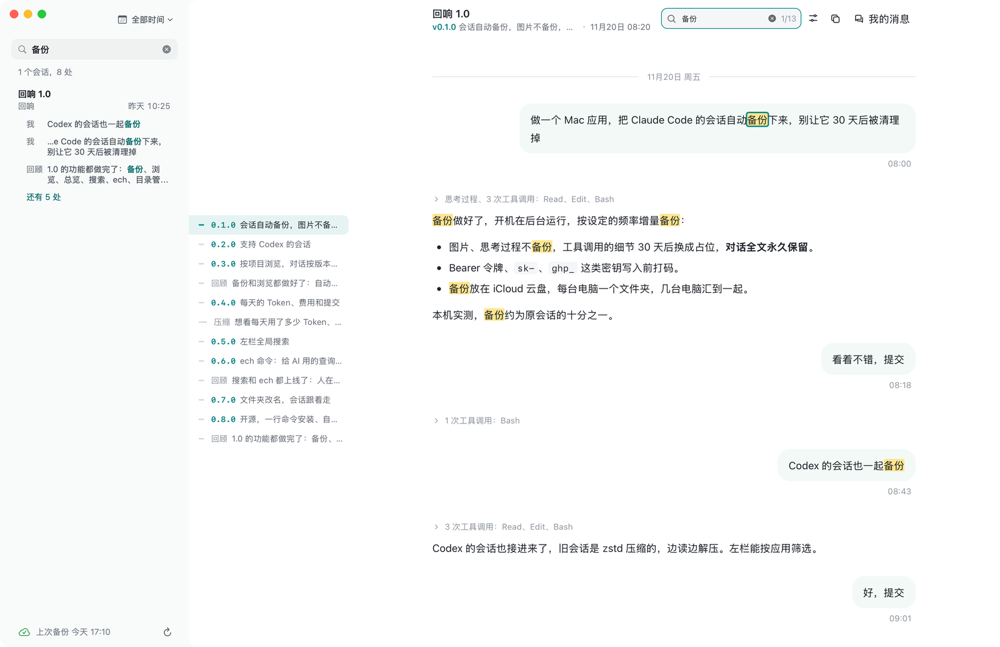
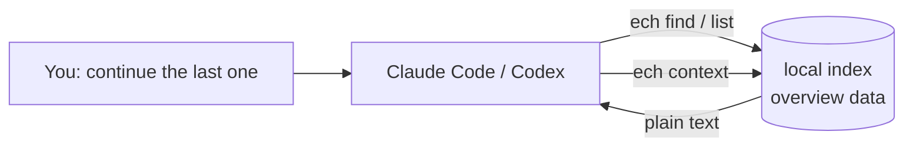
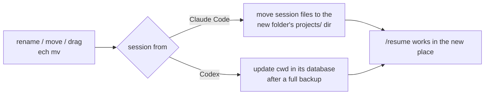

<p align="center"></p>

<h1 align="center">Echo（回响）</h1>

<p align="center">Everything you've talked through with AI, remembered.</p>

<p align="center">Local archiving, search and timeline review for Claude Code and Codex sessions, with <code>ech</code>, a command-line interface built for AI agents.</p>

<p align="center"><a href="README.md">中文</a></p>

<p align="center"><picture><source media="(prefers-color-scheme: dark)" srcset="docs/hero-dark.png"></picture></p>

> The app's interface is currently in Chinese.

## Why

When you work with Claude Code or Codex (writing proposals, changing code, organizing material), the valuable part is the process inside the sessions: why a decision was made, what was tried, how it was finally solved. That rarely makes it into docs, and the sessions themselves don't last:

- Claude Code cleans up sessions after 30 days by default. Sessions live per folder on one Mac; switch machines or folders and they're gone.
- Most of a session file is screenshots and intermediate data, so keeping them as-is takes a lot of space.
- Every new session starts from zero, and long sessions lose early details after a few compactions.

Echo archives these sessions in the background and indexes them, so you can find what was actually said by project, by version or by keyword, and it hands the same data to your AI through `ech`.

## Core capabilities

### Session archiving and full-text search

**Problem**: you remember discussing something but not which session; the original may already be cleaned up, or on your other Mac.

**How it works**:



- Incrementally backs up Claude Code and Codex sessions. Images and thinking are not backed up, tool call details become placeholders after 30 days by default, and the conversation text is kept forever. Bearer tokens, `sk-`, `ghp_` and similar secrets are masked before writing.
- Each Mac writes only its own folder and iCloud gathers them; every file has a single writer, so multiple Macs never conflict.
- The local full-text index is updated after each backup. Results rank session titles, your messages, summaries and AI replies in that order, grouped by session; click a hit to land on that exact line, highlighted.

**Value**: session storage drops by 80% or more without losing any conversation; millisecond search across all your Macs.

<p align="center"><picture><source media="(prefers-color-scheme: dark)" srcset="docs/search-dark.png"></picture></p>

### Version timeline and message navigation

**Problem**: a project's session easily runs thousands of turns with several compactions. To see how a version was decided, you scroll and scroll.

**How it works**:

- Conversations are segmented by version numbers in git commits, manual compactions and Claude's recaps. Click a keypoint on the left rail to jump there; the header shows the version you're in as you scroll.
- The "my messages" panel on the right lists everything you sent, by day; click one to jump to it, or search within it.
- Thinking and tool calls collapse into one line until you open them. Messages you typed while the AI was working show up as your messages.

**Value**: read a project version by version from start to finish, and explain every step clearly in a retro or handover.

<p align="center"><picture><source media="(prefers-color-scheme: dark)" srcset="docs/session-dark.png"></picture></p>

### A context interface for AI: ech

**Problem**: a new session doesn't know where you left off; weekly reports mean digging through chats and git log; letting the AI read raw session files is slow and burns tokens.

**How it works**:



Echo installs the `ech` command and a matching skill. When you ask "where did we leave off?" or "why did we decide this?", the AI looks it up itself. Query commands are read-only:

```text
$ ech context e0b9311e
回响 1.0 · 演示电脑 · e0b9311e · 第 7 段起（最近一次压缩之后）（第 57 行起）
最近一次回顾（11-22 10:26）：1.0 的功能都做完了：备份、浏览、总览、搜索、ech、目录管理、开源和自动更新。还没做的：记忆管理。

[11-21 10:19] 阶段总结：…
1. 备份、浏览、总览已完成
2. 下一步：全局搜索、给 AI 用的命令行

[11-21 10:32] 我：记得聊过，记不得在哪个会话，加个搜索
  · 工具 Read ~/Projects/回响/App/EchoApp.swift
  · 工具 Bash zsh 代码/应用/tests/run.sh
…
```

```text
$ ech list --since 7d
2026-11-17 至 2026-11-23：16 个会话，我的消息 111 条，Token 35.2M，提交 13 次（总览数据）
11-23 回响 · 记忆管理需求 · 5 条 · 1.3M · beff8384
11-22 回响 · 回响 1.0 · 16 条 · 4.5M · 提交 8（0.1.0 至 0.8.0 共 8 个版本） · e0b9311e
11-22 记账本 · 分类图标改版（续） · 8 条 · 2.5M · 提交 1（1.15.0） · ae5e3f1f
…
```

(Output is in Chinese for now: latest recap, compaction summary and the turns after it; sessions with message counts, tokens, commits and versions.)

**Value**: no re-briefing in new sessions, and Codex can pick up where Claude left off. Weekly reports and retros get every session, commit and version from one command, across all your Macs and AI tools.

### Session folder management

**Problem**: rename or move a project folder and Claude Code's `/resume` can't find its sessions; Codex groups sessions by the folder recorded in its database, which doesn't follow either; sessions pile up with no cleanup.

**How it works**:



- Rename or move folders in the sidebar tree and their sessions move along; drag sessions into other folders.
- Folders renamed in Finder or on a NAS are marked as missing; "Find new location" matches the most likely new folder by name and reconnects in one step.
- `ech mv` lets your AI bring sessions along when it reorganizes folders, with `--dry-run` to preview.
- Rename and delete sessions (to Trash, recoverable); sessions unused for a long time are moved to Trash once fully backed up.

**Value**: reorganize folders freely; sessions are never lost and still resume, and the session folders stop growing forever.

<p align="center"></p>

## More

- **Usage overview**: daily messages, token usage and estimated cost, AI working time; git commits and versions attached to their sessions; stats kept for deleted sessions.
- **Multiple apps**: Claude Code and Codex backed up, browsed and counted together, filterable by app.
- **Light and dark**: follows the system, or set it manually.
- **Auto update**: notifies you of new versions and installs them with one click, only if the signature matches the current version.


## Install

Run in Terminal:

```bash
curl -fsSL https://raw.githubusercontent.com/cyanext/Echo/main/install.sh | zsh
```

This installs the latest release to `~/Applications` and opens it. You can also download `Echo-<version>.zip` from [Releases](https://github.com/cyanext/Echo/releases) and drag Echo to Applications; if macOS says it can't verify the developer on first launch, go to System Settings > Privacy & Security and click "Open Anyway".

Requires macOS 14 or later on Apple silicon. On first launch, choose the backup location, the apps to back up and the cleanup rules; click "Allow" when macOS asks for folder access.

## ech commands

| Command | What it does |
|---|---|
| `ech find <keywords>` | Search all sessions, grouped by session, each hit with a reference (`session#segment`); filter with `--app`, `--since`, `--project`; `--tools` also searches tool calls |
| `ech segs <session>` | A session's segments: time range, versions committed, first line of each |
| `ech read <session>#<segment>` | Read the original text of a segment; `#L1200-1500` by line, `--tools` includes tool output |
| `ech context <session>` | Resume a session: latest recap, compaction summary and all turns after it |
| `ech list --since 7d` | Sessions, your messages, tokens, commits and versions by date; dates like `2026-11-16` or `11-16` also work |
| `ech mv <old path> <new path>` | Rename or move a folder, and local sessions move along; `--dry-run` to preview |
| `ech backup` / `ech index` | Back up now and update the index / update only the index and overview data |
| `ech schema [command]` | Each command's parameters as JSON, for AI agents |

Output is plain text, up to 8,000 characters per page, `--page` to page through, `--json` for scripts. The skill is installed to `~/.claude/skills/ech`, and to `~/.codex/skills/ech` when Codex is present.

## Privacy

- Echo only reads sessions in `~/.claude` and `~/.codex` and never edits their content. Session files change only when you rename, delete or move a session, or when auto cleanup is on; deletions always go to the Trash.
- Backups are written only to the folder you choose and are not uploaded anywhere except iCloud.
- Only two network requests, neither carrying any local information: a weekly download of a public model price list, and a daily update check (can be turned off in Settings).

## Build from source

Requires the Xcode command line tools and zstd (`brew install zstd`):

```bash
zsh 代码/应用/build.sh install
```

Without a signing certificate, the build is ad-hoc signed. See [开发说明.md](开发说明.md) (Chinese) for development notes.

## License

[MIT](LICENSE)
