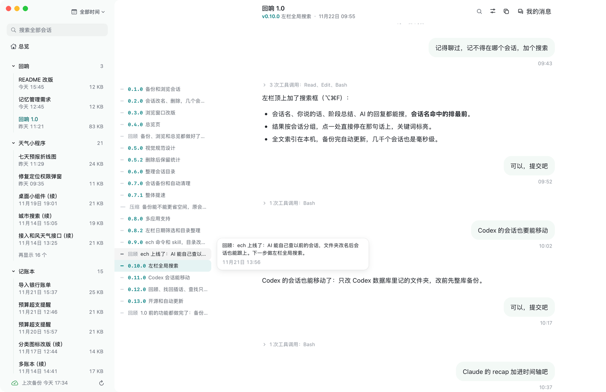
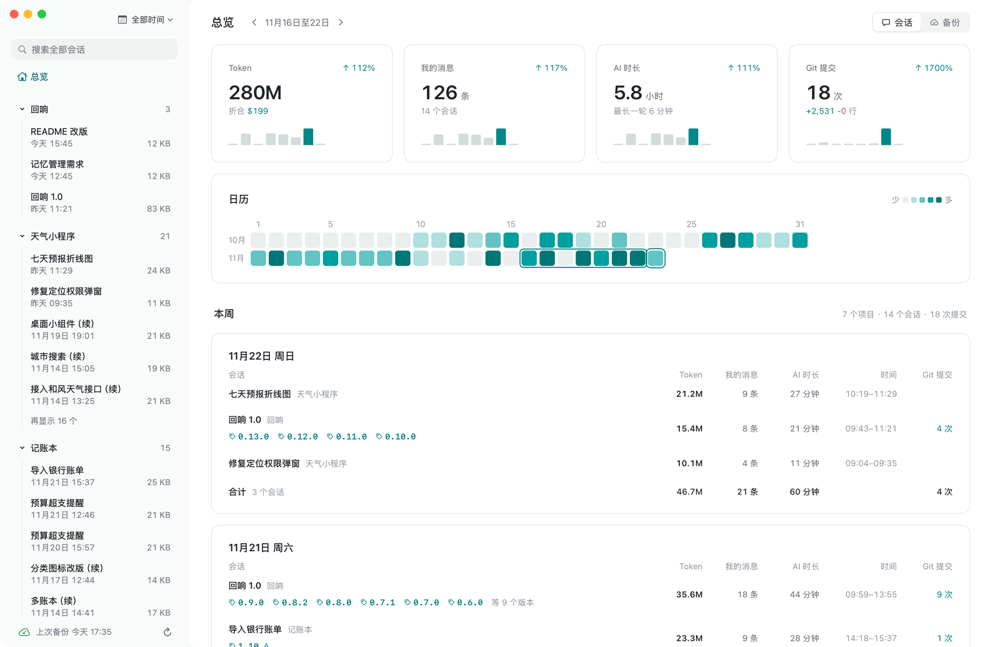
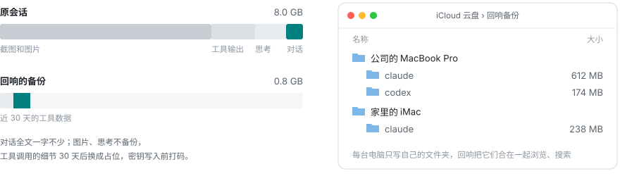
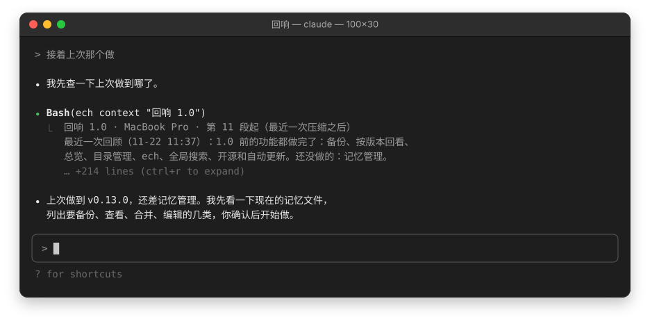
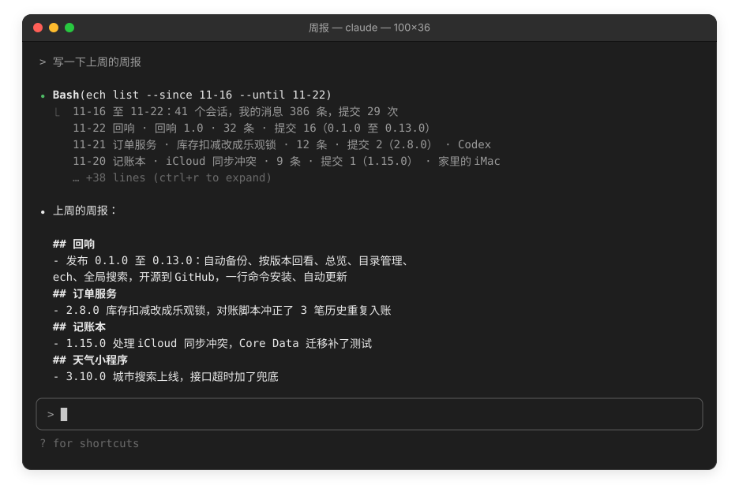
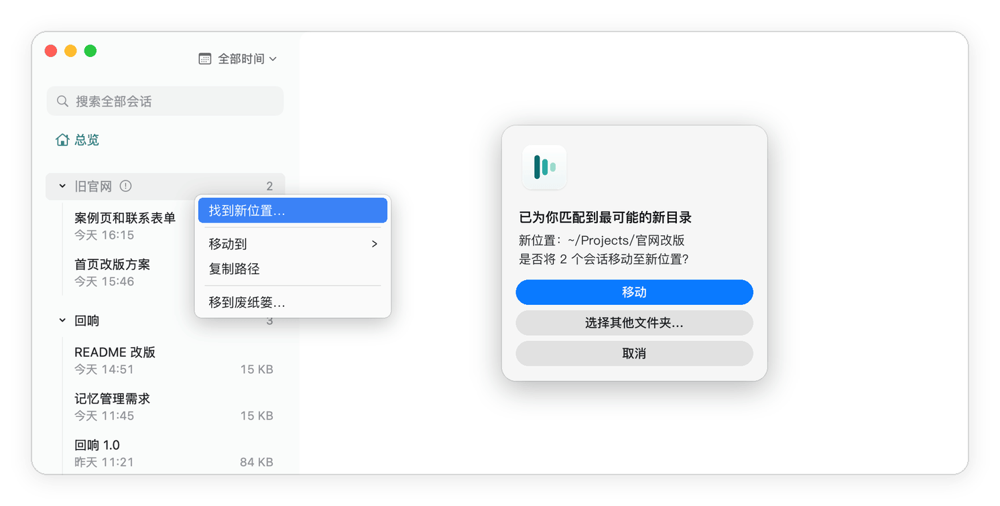

<p align="center"></p>

<h1 align="center">Echo（回响）</h1>

<p align="center">Everything you've talked through with AI, remembered.</p>

<p align="center">Backup, timeline review and search for Claude Code and Codex sessions, and your AI can look them up too.<br>A free, open-source Mac app. Your sessions are stored locally and safely.</p>

<p align="center"><a href="#install">Install</a> · <a href="README.md">中文</a></p>

<p align="center"><picture><source media="(prefers-color-scheme: dark)" srcset="docs/session-dark.png"></picture></p>

<p align="center"><picture><source media="(prefers-color-scheme: dark)" srcset="docs/overview-dark.png"></picture></p>

> The app's interface is currently in Chinese.

- **Automatic backup**: sessions survive the 30-day cleanup, take 80% less space, and gather across your Macs
- **Review by version**: long sessions split by version and recap, one click to jump back
- **Global search**: session titles, what you said, AI replies, found in milliseconds
- **ech**: your AI looks up past sessions itself and picks up where you left off
- **Folder management**: rename or move a folder and its sessions follow

## Automatic backup

Runs in the background at login and keeps your Claude Code and Codex sessions, safe from cleanup and visible from your other Mac.

- Images and thinking are not backed up, tool call details become placeholders after 30 days, and the conversation text is kept forever; 80% less space or more
- Secrets and tokens are masked before writing
- Backups live in iCloud Drive, one folder per Mac, so sessions from all your Macs come together
- Sessions unused for a long time are moved to Trash from Claude Code and Codex once fully backed up

<p align="center"></p>

## Review by version

A project's session easily runs thousands of turns with several compactions. Read it version by version, and retros and handovers become easy to explain.

- Conversations are split by version numbers in git commits, manual compactions and Claude's recaps; click a keypoint on the left rail to jump there, hover to see the full text
- The header shows the session title, with the version you're reading below it
- The "my messages" panel on the right lists everything you sent, by day
- Thinking and tool calls collapse into one line until you open them

## Global search

You remember discussing it but not which session: press ⌥⌘F and find it.

- Session titles, your messages, summaries and AI replies are all searchable, with title matches first
- Results are grouped by session; click a hit to land on that exact line, highlighted
- The full-text index is local and updated after each backup, milliseconds even across thousands of sessions

<p align="center"><picture><source media="(prefers-color-scheme: dark)" srcset="docs/search-dark.png"></picture></p>

## ech: Echo for your AI

Start a new session and say "continue the last one". Your AI checks Echo for where you left off, so you don't have to brief it again.

- Echo installs the `ech` command and a matching skill; works with Claude Code and Codex
- When you ask "where did we leave off?" or "why did we decide this?", the AI looks it up itself; queries are read-only
- Plain-text output, much faster and cheaper in tokens than letting the AI read raw session files

<p align="center"></p>

Weekly reports work the same way: one sentence, and the AI uses `ech list` to get a week of sessions, commits and versions across your Macs and AI tools, then writes it up by project.

<p align="center"></p>

## Folder management

Rename or move a folder and its sessions follow, so Claude Code can still `/resume` in the new place.

- Rename or move folders from the sidebar, or drag sessions into another folder
- Folders renamed in Finder or on a NAS are marked missing; "Find new location…" matches the new folder by name and reconnects in one step
- Codex sessions can be moved too; `ech mv` lets your AI bring sessions along when it reorganizes folders
- Rename or delete sessions; deletions go to the Trash and can be put back

<p align="center"></p>

## Overview

How many tokens you used each day and what they cost, how long the AI worked, which commits and versions you shipped.

- This week's tokens, messages, AI time and commits, compared with last week
- A calendar shows your busiest days; click a day to expand its sessions
- Git commits and versions are attached to their sessions; stats are kept for deleted sessions

## Install

Run in Terminal:

```bash
curl -fsSL https://raw.githubusercontent.com/cyanext/Echo/main/install.sh | zsh
```

This installs the latest release to `~/Applications` and opens it. You can also download `Echo-<version>.zip` from [Releases](https://github.com/cyanext/Echo/releases) and drag Echo to Applications; if macOS says it can't verify the developer on first launch, go to System Settings > Privacy & Security and click "Open Anyway".

Requires macOS 14 or later on Apple silicon. On first launch, choose the backup location, the apps to back up and the cleanup rules; click "Allow" when macOS asks for folder access.

## ech commands

| Command | What it does |
|---|---|
| `ech find <keywords>` | Search all sessions, grouped by session, each hit with a reference (`session#segment`); filter with `--app`, `--since`, `--project`; `--tools` also searches tool calls |
| `ech segs <session>` | A session's segments: time range, versions committed, first line of each |
| `ech read <session>#<segment>` | Read the original text of a segment; `#L1200-1500` by line, `--tools` includes tool output |
| `ech context <session>` | Resume a session: latest recap, compaction summary and all turns after it |
| `ech list --since 7d` | Sessions, your messages, tokens, commits and versions by date; dates like `2026-11-16` or `11-16` also work |
| `ech mv <old path> <new path>` | Rename or move a folder, and local sessions move along; `--dry-run` to preview |
| `ech backup` / `ech index` | Back up now and update the index / update only the index and overview data |
| `ech schema [command]` | Each command's parameters as JSON, for AI agents |

Output is plain text, up to 8,000 characters per page, `--page` to page through, `--json` for scripts. The skill is installed to `~/.claude/skills/ech`, and to `~/.codex/skills/ech` when Codex is present.

## Privacy

- Echo only reads sessions in `~/.claude` and `~/.codex` and never edits their content. Session files change only when you rename, delete or move a session, or when auto cleanup is on; deletions always go to the Trash.
- Backups are written only to the folder you choose and are not uploaded anywhere except iCloud.
- Only two network requests, neither carrying any local information: a weekly download of a public model price list, and a daily update check (can be turned off in Settings).

## Build from source

Requires the Xcode command line tools and zstd (`brew install zstd`):

```bash
zsh 代码/应用/build.sh install
```

Without a signing certificate, the build is ad-hoc signed. See [开发说明.md](开发说明.md) (Chinese) for development notes.

## License

[MIT](LICENSE)
