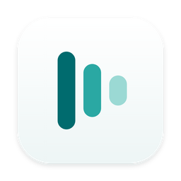

<p align="center"></p>

<h1 align="center">Echo（回响）</h1>

<p align="center">Everything you've talked through with AI, remembered.</p>

<p align="center">Automatically backs up your Claude Code and Codex sessions, so you can browse and search them anytime, and so can your AI.</p>

<p align="center"><a href="README.md">中文</a></p>

<p align="center"></p>

> The app's interface is currently in Chinese.

## Why

When you work with Claude Code or Codex (writing proposals, changing code, organizing material), the valuable part lives in the sessions: why a decision was made, what was tried, how it was finally solved. That rarely makes it into docs, and the sessions themselves don't last:

- Claude Code deletes sessions after 30 days by default.
- Sessions are scattered across folders and can only be resumed from the same folder on the same Mac. Rename the folder and `/resume` can't find them.
- Every new session starts from zero, and you have to explain the background again.

Echo backs up your sessions in the background, organizes them by project, and lets you browse and search them. It also ships a command-line tool, `ech`, that lets your AI look up past sessions itself and pick up where you left off.

## Use cases

- **"Why did we do it this way?"** A decision from three weeks ago, and the original session is long gone. Search a keyword in Echo, jump to the conversation around that commit, and read what was actually said.
- **Continue where you left off.** Start a new session and say "continue the last one". Your AI uses `ech` to find the latest recap and the last few turns, no re-briefing needed.
- **What did I do this week?** One command lists sessions, released versions and token usage per project, ready for a weekly report or retro.
- **Two Macs, one history.** Backups live in iCloud Drive, so you can browse and search sessions from your other Mac.
- **Reorganize folders without losing sessions.** Rename or move a folder in Echo and its sessions move along; Claude Code can resume them in the new location.

## Features

- **Automatic backup**: runs in the background at login and incrementally backs up Claude Code and Codex sessions on your schedule.
- **Compact storage**: images and thinking are not backed up, tool call details are replaced with placeholders after 30 days by default, and the conversation text is kept forever. Secrets and tokens are masked. Backups are about a tenth of the original size.
- **Multiple Macs**: one folder per Mac, gathered together through iCloud Drive.
- **Browse by project**: sessions are listed by folder; conversations are split by version commits, compactions and recaps, with a keypoint rail to jump around.
- **Global search**: session titles, your messages, summaries and AI replies, with matches highlighted.
- **Overview**: daily messages, token usage and cost, commits and versions.
- **Organize sessions**: rename, delete (to Trash, recoverable), move to another folder; sessions follow renamed folders.
- **Auto cleanup**: sessions you haven't used for a long time are moved to Trash from Claude Code and Codex once fully backed up.
- **`ech` command**: a CLI for AI agents to search sessions by keyword or date, read the original conversation, and resume context.
- **Auto update**: notifies you of new versions and installs them with one click.

## Install

Run in Terminal:

```bash
curl -fsSL https://raw.githubusercontent.com/cyanext/echo/main/install.sh | zsh
```

This downloads the latest release to `~/Applications` and opens it. You can also download `Echo-<version>.zip` from [Releases](https://github.com/cyanext/echo/releases) and drag Echo to Applications. If macOS says it can't verify the developer on first launch, go to System Settings > Privacy & Security and click "Open Anyway".

Requires macOS 14 or later on Apple silicon.

## Usage

1. On first launch, choose the backup location, the apps to back up and the cleanup rules, then start the backup. Click "Allow" when macOS asks for folder access.
2. Click Echo in the Dock to open the browser window. Closing the window keeps backups running in the background.
3. Ask your AI about past sessions, e.g. "where did we leave off?" or "why did we decide this?"; the installed `ech` skill does the lookup. You can use it yourself too:

| Command | What it does |
|---|---|
| `ech find <keywords>` | Search all sessions, grouped by session |
| `ech read <session>#<segment>` | Read the original text of a segment |
| `ech context <session>` | Resume a session: latest recap, summary and the turns after it |
| `ech list --since 7d` | List sessions, messages, tokens, commits and versions by date |
| `ech mv <old path> <new path>` | Rename or move a folder, and its sessions move along |
| `ech backup` | Back up now and update the index |

Run `ech help` for all commands; add `--json` for scripts.

## Privacy

- Echo only reads sessions in `~/.claude` and `~/.codex` and never edits their content. Session files are only changed when you rename, delete or move a session, or when auto cleanup is on; deletions always go to the Trash.
- Backups are written only to the folder you choose and are not uploaded anywhere except iCloud.
- Only two network requests, neither carrying any local information: a weekly download of a public model price list, and a daily update check (can be turned off in Settings).

## Build from source

Requires the Xcode command line tools and zstd (`brew install zstd`):

```bash
zsh 代码/应用/build.sh install
```

Without a signing certificate, the build is ad-hoc signed. See [开发说明.md](开发说明.md) (Chinese) for development notes.

## License

[MIT](LICENSE)
