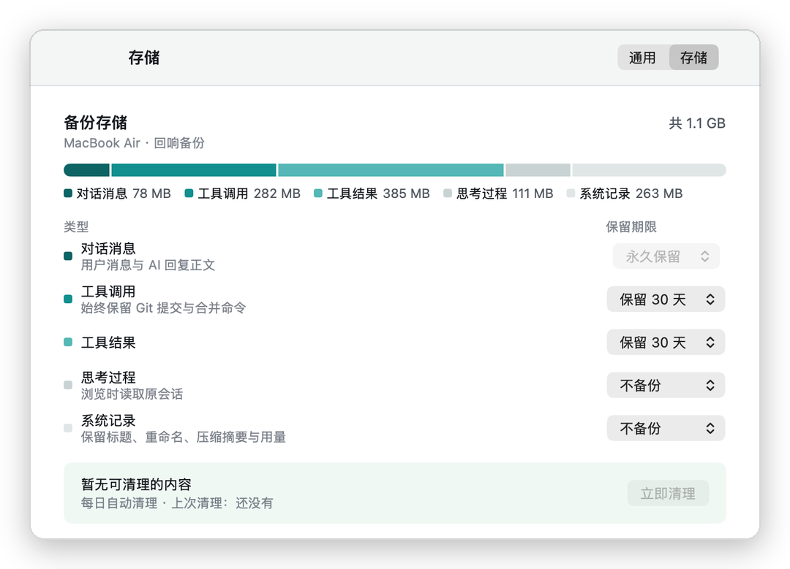
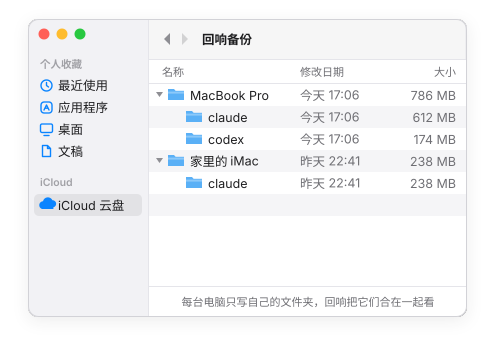
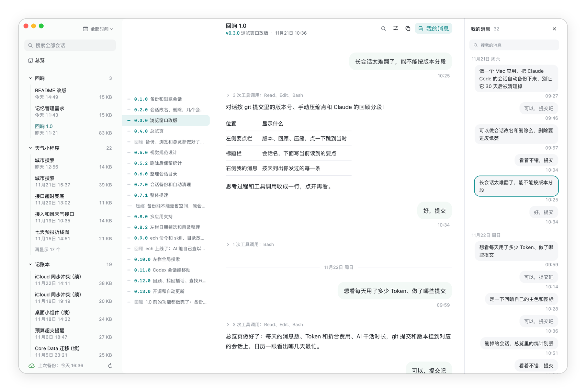
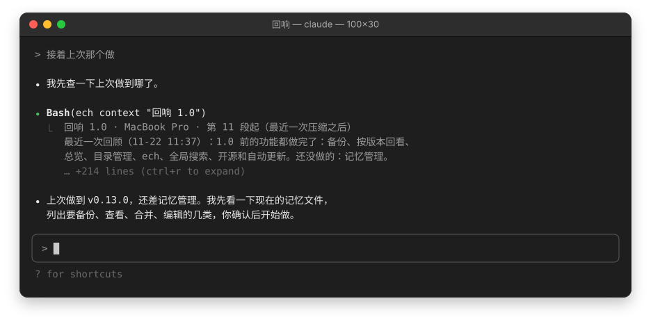
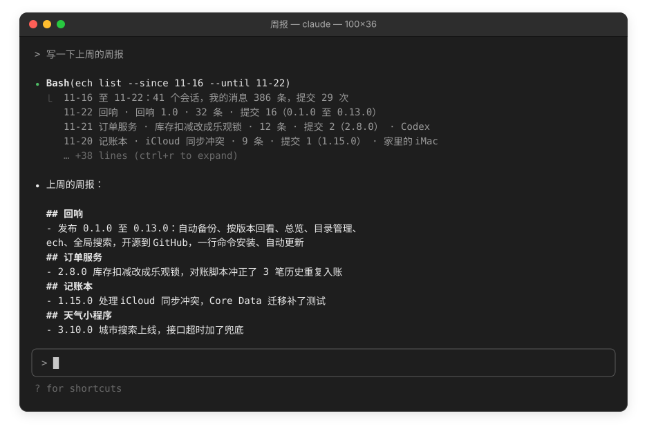

<p align="center"></p>

<h1 align="center">回响 Echo</h1>

<p align="center">你和 AI 聊过的，回响都记得。</p>

<p align="center">把 Claude Code、Codex 的会话自动存下来，你能翻能搜，AI 也能自己查。<br>开源免费的 Mac 应用，数据只存在你自己的电脑里。</p>

<p align="center"><a href="#安装">安装</a> · <a href="README.en.md">English</a></p>

用 Claude Code、Codex 干活，最值钱的常常是会话里的过程：当时为什么这么定、试过哪些路、最后怎么解决的。可 Claude Code 默认 30 天就清理会话，会话散在各个文件夹里，换台电脑也看不到。

回响把这些会话自动存下来，整理成一份能翻、能搜、AI 也能查的记录：

- **自动备份**：会话不会再被 30 天清理掉，备份比原会话小 80%，多台电脑的会话在一个界面里统一管理
- **按版本回看**：长会话按版本分好段，点一下就回到当时
- **全局搜索**：输入关键词，几毫秒找到当时的原话
- **ech**：AI 能自己查以前的会话，接着上次的进度做
- **目录管理**：给文件夹改名或挪位置，会话会跟着过去

<p align="center"><picture><source media="(prefers-color-scheme: dark)" srcset="docs/session-dark.png"></picture></p>

<p align="center"><picture><source media="(prefers-color-scheme: dark)" srcset="docs/overview-dark.png"></picture></p>

## 自动备份

回响在后台运行，自动备份 Claude Code 和 Codex 的会话。会话不会再被清理掉，换一台电脑也能看到。

- 对话全文永久保留；图片和思考过程不备份，工具调用的细节默认 30 天后换成占位。本机 7.6 GB 的会话，备份只占 1.1 GB
- 密钥和令牌在写入前打码
- 备份放在你自己的 iCloud 云盘里，每台电脑一个文件夹，多台电脑之间用 iCloud 同步，在一个界面里统一管理
- 很久没用的会话，确认备份完整后移到废纸篓，原来的文件夹不会越攒越大
- 菜单栏图标显示备份状态，点开可以立即备份、打开最近的会话

<p align="center"><picture><source media="(prefers-color-scheme: dark)" srcset="docs/storage-dark.png"></picture> </p>

## 按版本回看

一个项目的会话常常有几千轮，中间还压缩过好几次。回响按版本把它分成段，复盘、交接时从头看一遍就清楚。

- 按 git 提交里的版本号、手动压缩和 Claude 的回顾分段，点左边的要点就跳过去，悬停能看全文
- 标题栏下面一行写着你正在读的版本
- 右边「我的消息」按天列出你发过的每一条，点一下就定位过去
- 思考过程和工具调用默认收成一行，要看再点开

<p align="center"><picture><source media="(prefers-color-scheme: dark)" srcset="docs/timeline-dark.png"></picture></p>

## 全局搜索

记得聊过，却想不起在哪个会话？按 ⌥⌘F 搜一下。

- 搜索范围包括会话名、你说的话、阶段总结和 AI 的回复，会话名命中的排在最前
- 结果按会话分组，点一条就停在那句话上，关键词会标亮
- 索引存在本机，备份完自动更新，几千个会话也是几毫秒出结果

<p align="center"><picture><source media="(prefers-color-scheme: dark)" srcset="docs/search-dark.png"></picture></p>

## ech：给 AI 用的回响

新开一个会话，说一句「接着上次那个做」，AI 会自己去回响里查上次做到哪，不用你再讲一遍背景。

- 装好回响就带了 `ech` 命令和配套的 skill，Claude Code 和 Codex 都能用
- 你问「上次聊到哪了」「当时为什么这么定」，AI 会自己去查；查询只读，不会改动任何文件
- 输出是纯文本，比让 AI 直接读原会话快得多，也更省 Token

<p align="center"></p>

写周报也是一句话的事。AI 用 `ech list` 拿到一周里所有电脑、所有 AI 的会话、提交和版本，按项目整理出来。

<p align="center"></p>

## 会话目录管理

给文件夹改名或挪了位置，里面的会话会跟着过去，Claude Code 在新位置照样能 `/resume`。

- 在左栏目录上右键就能改名、移动，也可以把会话直接拖进别的文件夹
- 在访达或 NAS 上改过名的文件夹，左栏会标「已不存在」。右键选「找到新位置…」，回响按名字找到新文件夹，一步接上
- Codex 的会话也能移动。AI 整理目录时用 `ech mv`，会把会话一起带走
- 会话可以改名、删除，删掉的会话进废纸篓，随时能放回

<p align="center"></p>

## 总览

每天用了多少 Token、花了多少钱、AI 干了多久、做了哪些提交和版本，在总览里一眼看清。

- 顶部卡片是本周的 Token、消息数、AI 时长和提交数，并和上周对比
- 日历标出哪几天最忙，点一天就展开当天的会话
- 每次提交和版本都挂在对应的会话上。删掉的会话，统计仍然保留

## 安装

在终端里运行这一行：

```bash
curl -fsSL https://raw.githubusercontent.com/cyanext/Echo/main/install.sh | zsh
```

它会下载最新版，装到 `~/Applications` 并打开。也可以到 [Releases](https://github.com/cyanext/Echo/releases) 下载 `Echo-<版本>.zip`，解压后把「回响」拖进「应用程序」。用浏览器下载的，第一次打开会提示「无法验证开发者」，到「系统设置 › 隐私与安全性」底部点「仍要打开」就行。

需要 Apple 芯片的 Mac、macOS 14 或更新版本，目前支持 Claude Code 和 Codex 的会话。第一次打开时，按引导选好备份位置、要备份的应用和清理规则；macOS 问能不能访问文件夹时，点「允许」。

## ech 命令

| 命令 | 做什么 |
|---|---|
| `ech find <关键词>` | 在全部会话里搜关键词，按会话列出命中的地方，每处附一个引用（`会话#段号`）。可以用 `--app`、`--since`、`--project` 过滤，加 `--tools` 连工具调用一起搜 |
| `ech segs <会话>` | 列出会话的分段：起止时间、提交的版本、每段第一句话 |
| `ech read <会话>#<段号>` | 读一段对话原文。`#L1200-1500` 按行读，加 `--tools` 带上工具输出 |
| `ech context <会话>` | 接上一个会话：给出最近的回顾、阶段总结和之后的全部对话 |
| `ech list --since 7d` | 按时间列出会话、我的消息、Token、提交和版本。日期也能写成 `2026-11-16`、`11-16` |
| `ech mv <旧路径> <新路径>` | 给文件夹改名或移动，本机的会话跟着过去。加 `--dry-run` 先预览 |
| `ech backup` / `ech index` | 立即备份并更新索引 / 只更新索引和总览数据 |
| `ech schema [命令]` | 列出各命令的参数（JSON），给 AI 看 |

输出是纯文本，一页最多 8000 字，用 `--page` 翻页，加 `--json` 给脚本用。配套的 skill 装在 `~/.claude/skills/ech`，本机装了 Codex 时也会装到 `~/.codex/skills/ech`。

## 数据安全

- 回响只读取 `~/.claude`、`~/.codex` 里的会话，不改动内容。只有你改名、删除、移动会话，或开启了自动清理时，才会动会话文件，删除一律进废纸篓。
- 备份只写到你选的文件夹。除了 iCloud，不会传到任何地方。
- 只有两处联网，都只发一个请求，不带任何本机信息：每周下载一次公开的模型价格表；每天检查一次新版本，可以在设置里关掉。

## 从源码编译

需要 Xcode 命令行工具和 zstd（`brew install zstd`）：

```bash
zsh 代码/应用/build.sh install
```

没有签名证书时用临时签名。开发说明见 [开发说明.md](开发说明.md)。

## 许可

[MIT](LICENSE)
