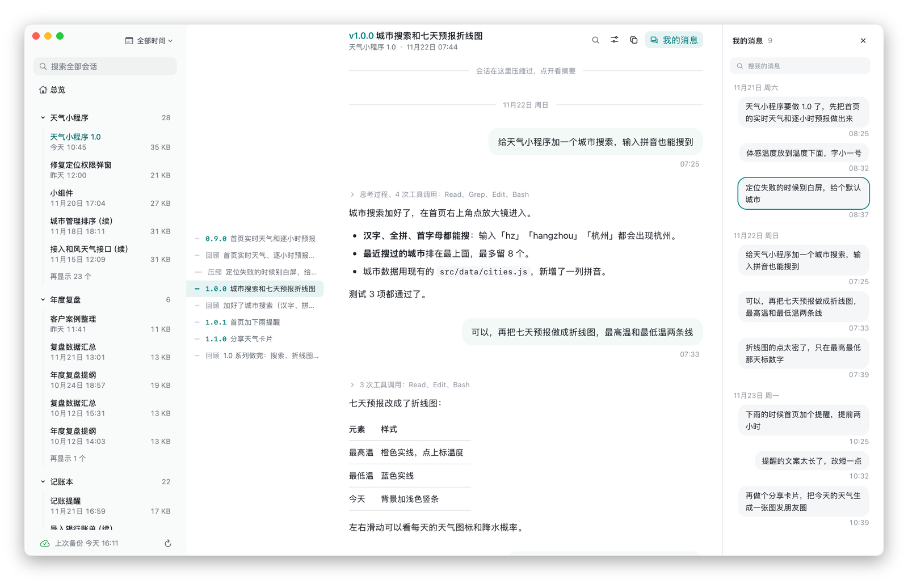
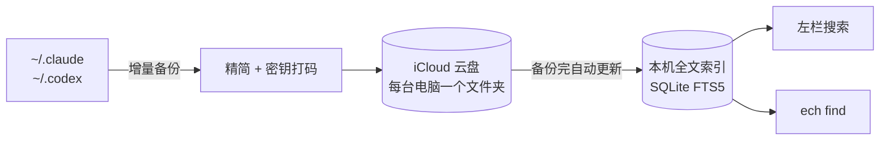
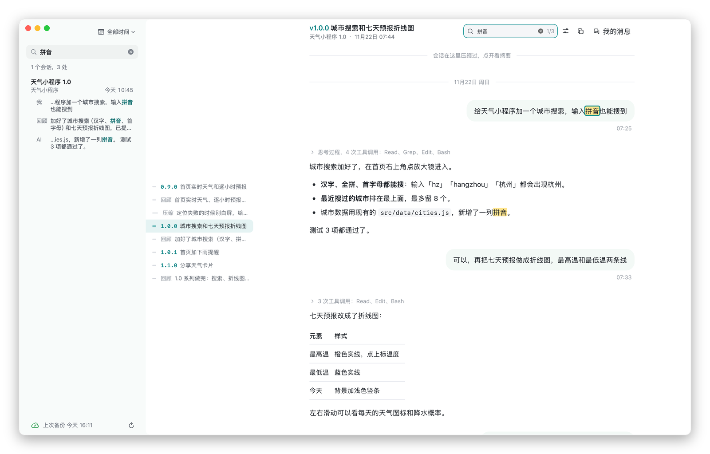
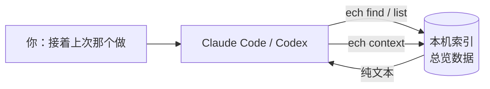
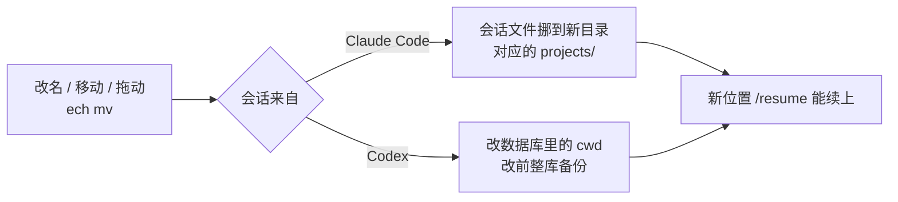
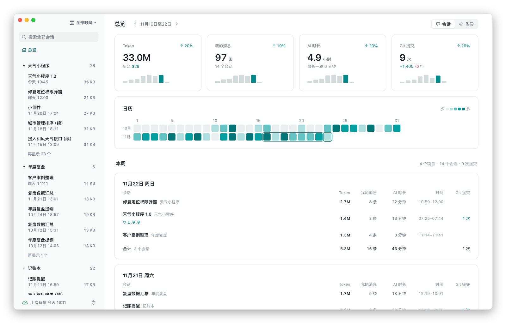

<p align="center"></p>

<h1 align="center">回响 Echo</h1>

<p align="center">你和 AI 聊过的，回响都记得。</p>

<p align="center">Claude Code、Codex 会话的本地归档、检索与回看工具，附带给 AI 用的命令行接口 <code>ech</code>。</p>

<p align="center"><a href="README.en.md">English</a></p>

<p align="center"></p>

## 为什么需要它

用 Claude Code、Codex 写方案、改代码、整理资料，真正有价值的是会话里的过程：当时为什么这么定、试过哪些路、最后怎么解决的。这些很少写进文档，而会话本身留不住：

- Claude Code 默认 30 天清理会话；会话按文件夹存在本机，换一台电脑、换一个目录就找不到。
- 会话文件里大部分是截图和过程数据，原样长期保存很占空间。
- 每开一个新会话，AI 都从零开始；长会话压缩几次后，早先的细节也没了。

回响在后台归档这些会话，建好索引，让你按项目、按版本、按关键词找回当时的原话；同时把同一份数据通过 `ech` 交给 AI，让它自己查。

## 核心能力

### 会话归档与全文检索

**痛点**：记得聊过，记不得在哪个会话；原会话可能已经被清理，或者在另一台电脑上。

**实现**：



- 增量备份 Claude Code、Codex 的会话。图片、思考过程不备份，工具调用的细节默认 30 天后换成占位，对话全文永久保留；Bearer 令牌、`sk-`、`ghp_` 等密钥写入前打码。
- 每台电脑只写自己的文件夹，经 iCloud 汇总，一个文件只有一个写入者，多台电脑不冲突。
- 备份完增量更新本机全文索引。会话名、你说的话、阶段总结、AI 的回复按这个优先级排序，结果按会话分组，点一处直接停在那句话上并标亮。

**价值**：会话占用下降 80% 以上，对话信息不丢；多台电脑的会话毫秒级检索。

<p align="center"></p>

### 版本时间轴与消息定位

**痛点**：一个项目的会话动辄几千轮、压缩好几次，想知道「某个版本当时怎么定的」，只能一路往上翻。

**实现**：

- 对话按 git 提交里的版本号、手动压缩点和 Claude 的回顾（recap）分段，左侧要点栏一点就跳到当时；标题栏随滚动显示当前所在的版本。
- 右侧「我的消息」按天列出你发过的每一条，点一条定位到那句话，也能在里面搜。
- 思考过程和工具调用收成一行，点开再看；AI 干活时你插进去的话也按你的消息显示。

**价值**：一个项目按版本从头看到尾，复盘、交接时能讲清楚每一步为什么这么做。

### 面向 AI 的上下文接口：ech

**痛点**：新会话不知道上次做到哪；写周报要翻聊天记录、翻 git log；AI 自己去读原会话文件又慢又费 Token。

**实现**：



回响装好后自带命令行工具 `ech` 和配套 skill。AI 听到「上次聊到哪了」「以前为什么这么定」时自己去查，查询命令只读：

```text
$ ech context 968abfee
天气小程序 1.0 · 演示电脑 · 968abfee · 第 3 段起（最近一次压缩之后）（第 28 行起）
最近一次回顾（11-23 10:46）：1.0 系列做完：搜索、折线图、下雨提醒、分享卡片，最新是 v1.1.0。还没做的：小组件。

[11-21 09:47] 阶段总结：…
1. 首页实时天气、逐小时预报已完成（v0.9.0）
2. 定位失败时用上次的城市，默认北京
3. 下一步：城市搜索、七天预报

[11-22 07:25] 我：给天气小程序加一个城市搜索，输入拼音也能搜到
  · 工具 Read ~/Projects/天气小程序/src/pages/index/index.js
…
```

```text
$ ech list --since 7d
2026-11-17 至 2026-11-23：12 个会话，我的消息 84 条，Token 28.8M，提交 10 次（总览数据）
11-23 天气小程序 · 天气小程序 1.0 · 9 条 · 3.8M · 提交 4（0.9.0、1.0.0、1.0.1、1.1.0） · 968abfee
11-22 天气小程序 · 修复定位权限弹窗 · 8 条 · 2.7M · 21f593c8
11-22 年度复盘 · 客户案例整理 · 4 条 · 1.3M · 942bdaf4
11-21 记账本 · 记账提醒 · 6 条 · 1.6M · 提交 1（1.9.0） · b04e5b6a
…
```

**价值**：新会话不用重新交代背景，Codex 也能接上 Claude 的进度；周报、复盘一条命令拿到全部会话、提交和版本，各台电脑、各家 AI 都在。

### 会话目录管理

**痛点**：项目文件夹一改名、一挪位置，Claude Code 的 `/resume` 就找不到原来的会话；Codex 按它数据库里记的目录归类，也跟不过去；会话越攒越多，没人清理。

**实现**：



- 左栏目录树里给文件夹改名、移动，会话随之移动；会话可以拖到别的文件夹。
- 在访达或 NAS 上改过名的文件夹，左栏标出「已不存在」，右键「找到新位置」按名字匹配出最可能的新目录，一步接上。
- `ech mv` 让 AI 整理目录时把会话一起带走，`--dry-run` 先预览。
- 会话改名、删除（移到废纸篓，能放回）；很久没用的会话，备份完整后自动移到废纸篓。

**价值**：文件夹随便整理，会话不丢、照样能续上，本机的会话目录也不再越攒越大。

## 其他功能

- **用量总览**：每天的消息数、Token 用量和折合费用、AI 干活时长，git 提交和版本挂到对应的会话上；删掉的会话统计照算。
- **多应用**：Claude Code、Codex 一起备份、浏览、统计，按应用筛选。
- **浅色、深色**：跟随系统，也能手动切换。
- **自动更新**：有新版本时提示，一键下载安装，签名和当前版本一致才替换。

<p align="center"></p>

## 安装

在终端里运行：

```bash
curl -fsSL https://raw.githubusercontent.com/cyanext/Echo/main/install.sh | zsh
```

会下载最新版装到 `~/Applications` 并打开。也可以到 [Releases](https://github.com/cyanext/Echo/releases) 下载 `Echo-<版本>.zip`，解压后把「回响」拖到「应用程序」；用浏览器下载的，第一次打开如果提示「无法验证开发者」，到「系统设置 > 隐私与安全性」底部点「仍要打开」。

需要 macOS 14 或更新的版本、Apple 芯片。第一次打开按引导选好备份位置、要备份的应用和清理规则，macOS 询问能否访问文件夹时点「允许」。

## ech 命令

| 命令 | 做什么 |
|---|---|
| `ech find <关键词>` | 在全部会话里找，按会话列出命中处，每处带一个引用（`会话#段号`）；`--app`、`--since`、`--project` 过滤，`--tools` 连工具调用一起找 |
| `ech segs <会话>` | 会话的分段：起止时间、提交的版本、每段第一句话 |
| `ech read <会话>#<段号>` | 读一段对话的原文；`#L1200-1500` 按行读，`--tools` 带上工具输出 |
| `ech context <会话>` | 续上一个会话：最近的回顾、阶段总结和之后的全部对话 |
| `ech list --since 7d` | 按时间列会话、我的消息、Token、提交和版本；日期也能写 `2026-11-16`、`11-16` |
| `ech mv <旧路径> <新路径>` | 改文件夹名或移动文件夹，本机的会话随之移动；`--dry-run` 预览 |
| `ech backup` / `ech index` | 立即备份并更新索引 / 只更新索引和总览数据 |
| `ech schema [命令]` | 各命令的参数（JSON），给 AI 看 |

输出纯文本，一页最多 8000 字，`--page` 翻页，`--json` 给脚本用。配套 skill 装在 `~/.claude/skills/ech`，本机有 Codex 时也装到 `~/.codex/skills/ech`。

## 数据安全

- 只读 `~/.claude`、`~/.codex` 里的会话，会话内容一行不改。只有你点了改名、删除、移动，或开着自动清理时，才会改动会话文件；删除一律移到废纸篓。
- 备份只写到你选的文件夹，除了 iCloud 不传到任何地方。
- 联网只有两处，都只发一个请求，不带任何本机信息：每周下载一次公开的模型价格表，每天检查一次新版本（可在设置里关掉）。

## 从源码编译

需要 Xcode 命令行工具和 zstd（`brew install zstd`）：

```bash
zsh 代码/应用/build.sh install
```

没有签名证书时用临时签名。开发说明见 [开发说明.md](开发说明.md)。

## 许可

[MIT](LICENSE)
