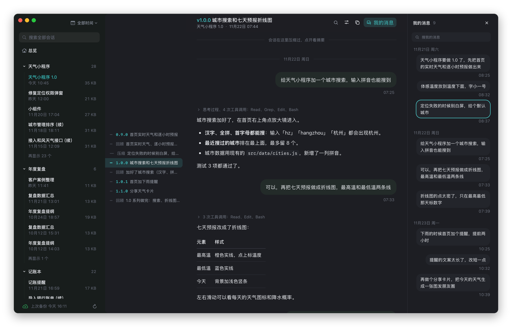

<p align="center"></p>

<h1 align="center">回响 Echo</h1>

<p align="center">你和 AI 聊过的，回响都记得。</p>

<p align="center">自动备份 Claude Code、Codex 的会话，随时翻看、搜索，AI 也能自己查。</p>

<p align="center"><a href="README.en.md">English</a></p>

<p align="center"></p>

## 为什么需要它

用 Claude Code、Codex 做事，写方案、改代码、整理资料，真正有价值的东西都在会话里：当时为什么这么定、试过哪些路、最后怎么解决的。这些很少写进文档，可会话本身留不住：

- Claude Code 默认 30 天就删掉会话。
- 会话散在各个文件夹里，只能在同一个文件夹、同一台电脑上找回来；文件夹改个名，`/resume` 就找不到了。
- 每开一个新会话，AI 都从零开始，上次的背景要你再讲一遍。

回响在后台把会话备份下来，按项目整理好，随时翻看、搜索；还带一个命令行工具 `ech`，让 AI 自己去查以前的会话，接着上次的进度做。

## 用在哪儿

- **「这里当时为什么这么做？」** 三周前定的方案，原会话早被删了。在回响里搜一个关键词，跳到那次提交前后的对话，看到当时的原话和取舍。
- **新会话接上旧进度。** 新开一个会话说「接着上次那个做」，AI 用 `ech` 找到上次的回顾和最后几段对话，不用你重新交代背景。
- **一周做了什么，一条命令列出来。** 每个项目的会话、提交的版本、用了多少 Token，写周报、做复盘直接用。
- **两台 Mac，会话汇到一起。** 备份放在 iCloud 云盘，在家里那台上也能翻、能搜公司那台上的会话。
- **整理文件夹不丢会话。** 在回响里给文件夹改名、挪位置，里面的会话跟着走，Claude Code 在新位置照样能接着聊。

## 功能

- **自动备份**：开机在后台运行，按设定的频率增量备份 Claude Code、Codex 的会话。
- **精简存储**：图片、思考过程不备份，工具调用的细节默认 30 天后换成占位，对话全文一直保留；密钥、令牌自动打码。备份约为原会话的十分之一。
- **多台电脑**：每台电脑一个文件夹，放在 iCloud 云盘里自动汇到一起。
- **按项目浏览**：左栏按文件夹列出会话；对话按版本提交、压缩点和回顾分段，右侧的要点一点就跳到当时。
- **全局搜索**：会话名、你说的话、阶段总结、AI 的回复都能搜，命中处高亮。
- **总览**：每天的消息数、Token 用量和费用，做了哪些提交和版本。
- **整理会话**：改名、删除（移到废纸篓，能放回）、移动到别的文件夹；文件夹改名后会话跟着走。
- **自动清理**：Claude Code、Codex 里很久没用的会话，备份完整后移到废纸篓，原来的文件夹不再越攒越大。
- **ech 命令**：给 AI 用的命令行工具，按关键词、时间查会话，读出当时的原话，接上上次的进度。
- **自动更新**：有新版本时提示，点「更新」自动下载安装。

<p align="center"></p>

## 安装

在终端里运行：

```bash
curl -fsSL https://raw.githubusercontent.com/cyanext/Echo/main/install.sh | zsh
```

会下载最新版装到 `~/Applications` 并打开。也可以到 [Releases](https://github.com/cyanext/Echo/releases) 下载 `Echo-<版本>.zip`，解压后把「回响」拖到「应用程序」。用浏览器下载的，第一次打开如果提示「无法验证开发者」，到「系统设置 > 隐私与安全性」底部点「仍要打开」。

需要 macOS 14 或更新的版本、Apple 芯片。

## 使用

1. 第一次打开时按引导选好备份位置、要备份的应用和清理规则，点「完成，开始备份」。macOS 询问能否访问文件夹时点「允许」。
2. 点程序坞里的回响打开浏览窗口。关掉窗口后照常在后台备份。
3. 让 AI 查以前的会话：直接说「上次聊到哪了」「以前为什么这么定」，回响装好的 `ech` skill 会去查。自己在终端里也能用：

| 命令 | 做什么 |
|---|---|
| `ech find <关键词>` | 在全部会话里找，按会话列出命中处 |
| `ech read <会话>#<段号>` | 读一段对话的原文 |
| `ech context <会话>` | 续上一个会话：最近的回顾、阶段总结和之后的对话 |
| `ech list --since 7d` | 按时间列会话、消息数、Token、提交和版本 |
| `ech mv <旧路径> <新路径>` | 改文件夹名或移动文件夹，会话随之移动 |
| `ech backup` | 立即备份并更新索引 |

`ech help` 看全部命令，加 `--json` 输出给脚本用。

## 数据安全

- 只读 `~/.claude`、`~/.codex` 里的会话，会话内容一行不改。只有你点了改名、删除、移动，或开着自动清理时，才会改动会话文件；删除一律移到废纸篓。
- 备份只写到你选的文件夹，除了 iCloud 不传到任何地方。
- 联网只有两处，都只发一个请求，不带任何本机信息：每周下载一次公开的模型价格表，每天检查一次新版本（可在设置里关掉）。

## 从源码编译

需要 Xcode 命令行工具和 zstd（`brew install zstd`）：

```bash
zsh 代码/应用/build.sh install
```

没有签名证书时用临时签名。开发说明见 [开发说明.md](开发说明.md)。

## 许可

[MIT](LICENSE)
